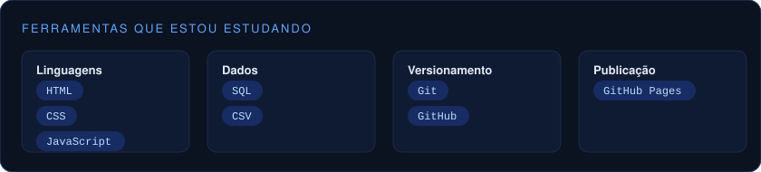
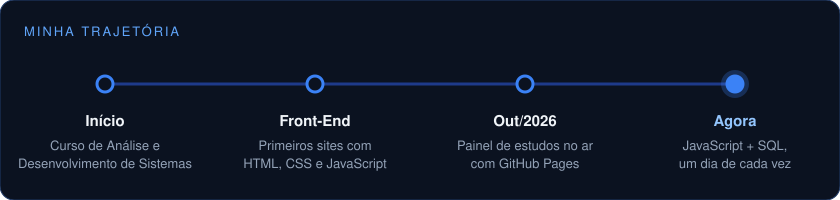
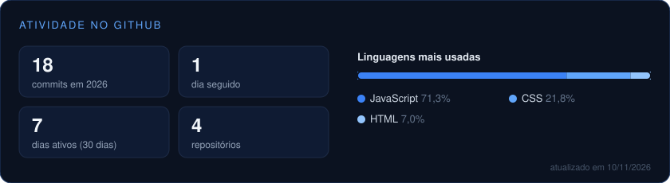

  

  
  

---

## 👋 Sobre mim

Sou estudante de **Análise e Desenvolvimento de Sistemas** na **UNICID** e estou construindo minha base em desenvolvimento web.

Gosto de aprender na prática: cada conteúdo novo vira um commit, e cada semana de estudo vira uma funcionalidade nova em algum projeto.

> 🎯 Meu objetivo agora é dominar o essencial de **HTML, CSS, JavaScript e SQL** e transformar isso em projetos reais.

---

## 🧰 Ferramentas

  

---

## 🧭 Trajetória

  

---

## 🚀 Projetos

<table>
  <tr>
    <td width="50%" valign="top">
      
      <h3>🪚 Plano de Corte</h3>
      
Otimizador de chapas: calcula o encaixe das peças com cortes em guilhotina, descontando serra, refilo e veio, e desenha o plano de cada chapa.

      
<code>JavaScript</code> <code>algoritmos</code> <code>SVG</code> <code>testes</code>

      <a href="https://gabrielevaristo77.github.io/plano-de-corte/">Ver site</a> · <a href="https://github.com/GabrielEvaristo77/plano-de-corte">Código</a>
    </td>
    <td width="50%" valign="top">
      
      <h3>🌤️ Clima Agora</h3>
      
Previsão do tempo com busca de cidades, gráfico das próximas 24 horas, previsão da semana e favoritos, consumindo a API Open-Meteo.

      
<code>JavaScript</code> <code>API REST</code> <code>async/await</code> <code>testes</code>

      <a href="https://gabrielevaristo77.github.io/clima-agora/">Ver site</a> · <a href="https://github.com/GabrielEvaristo77/clima-agora">Código</a>
    </td>
  </tr>
  <tr>
    <td width="50%" valign="top">
      
      <h3>📚 Painel de estudos</h3>
      
Registro diário dos meus estudos, transformado em um painel com resumo de horas e sequência de dias seguidos.

      
<code>HTML</code> <code>CSS</code> <code>JavaScript</code> <code>CSV</code>

      <a href="https://gabrielevaristo77.github.io/painel-de-estudos/">Ver site</a> · <a href="https://github.com/GabrielEvaristo77/painel-de-estudos">Código</a>
    </td>
    <td width="50%"></td>
  </tr>
</table>

  

---

## 📊 Atividade no GitHub

  

Cartão gerado automaticamente todo dia pelo GitHub Actions.

---

  <b>Vamos trocar ideias?</b> Me chama no <a href="https://www.linkedin.com/in/gabriel-evaristo-macieira-b81b6825a">LinkedIn</a>. 
  Aprendendo um pouco todo dia. 💙

